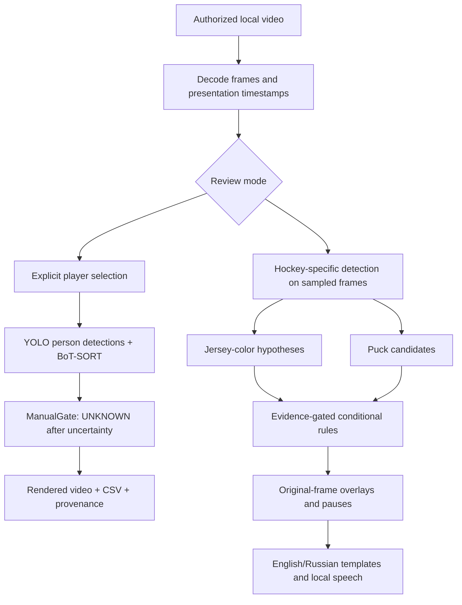

# Architecture

## Active components

| File | Responsibility |
|---|---|
| `hockey_ai_analytics/v6/server.py` | Localhost HTTP service, session token, upload, jobs, media endpoints |
| `engine.py` | Timestamp validation, model inference/cache fingerprints, frame export/render validation |
| `gate.py` | Bind explicit player box; do not reconnect automatically after uncertainty |
| `coach.py` | Approximately 1 Hz scene sampling, color and puck candidates, conditional rules, bilingual narration |
| `web/app.js` | Original manual-selection workflow |
| `web/coach.js` | Coaching interval selection, pause playback, overlays and language/voice controls |

The two branches do not share verified persistent player identities. Coaching player mode is anchored at one explicitly selected frame; other samples remain UNKNOWN. Generic tracking uses YOLO11s; coaching uses HockeyAI. Failed research heads are not connected to either production path.

## Service contract

- `GET /api/bootstrap`: session token and private demo availability.
- `POST /api/upload`: video bytes plus filename header; returns video ID.
- `GET /api/videos/<id>`: preparation status and metadata.
- `POST /api/analyze`: video ID and ordered explicit selections.
- `POST /api/coach`: video ID, start/end seconds, mode, color and optional player selection.
- `GET /api/jobs/<id>`: progress and resulting report.
- `POST /api/cancel`: cancellation request.
- `/media/<id>/<allowed-file>`: reviewed assets and exports; no arbitrary path access.

Mutations require the per-process session token; origin/host validation and response security headers are enabled. This is a local application, not a hardened multi-user hosted service. Do not expose its port to the public internet.

## Output meanings

TRACKING is a model hypothesis, not proof of personnel identity. UNKNOWN means evidence is insufficient. A manual anchor is a user's choice, not independent GT. Marker coverage is not identity accuracy. A unique puck candidate is not possession. A clear image line is not a guaranteed pass or safe skating route.

Jobs and videos are registered in memory; saved files remain on disk after restart but their routes are not restored automatically. This is tracked as a setup/persistence issue.
